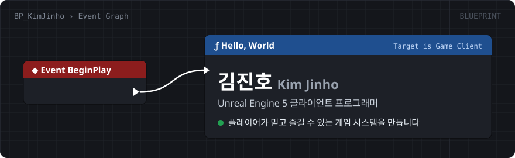
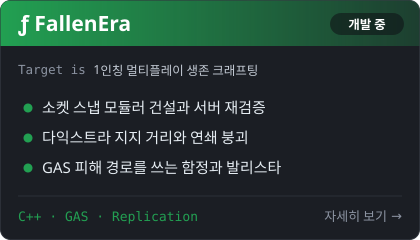
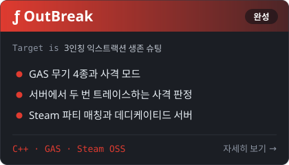
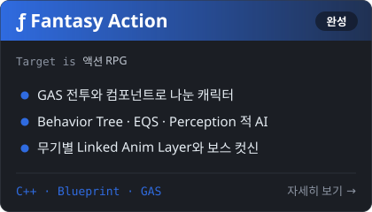
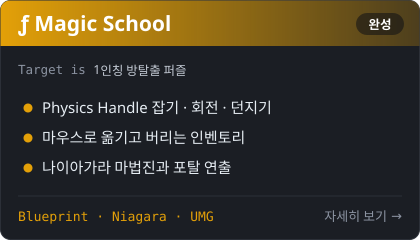

<a href="https://colloderm.github.io/"></a>

<p align="center">
  <a href="https://colloderm.github.io/"></a>
</p>

## 🧩 Tech Stack

```cpp
UCLASS(Blueprintable)
class AKimJinho : public AGameClientProgrammer
{
    GENERATED_BODY()

    UPROPERTY(EditAnywhere, Category = "Engine")
    TArray<FString> Engine   = { "Unreal Engine 5", "C++", "Blueprint" };

    UPROPERTY(EditAnywhere, Category = "Gameplay")
    TArray<FString> Gameplay = { "GAS", "Behavior Tree", "EQS", "Niagara", "UMG / MVVM" };

    UPROPERTY(EditAnywhere, Category = "Network")
    TArray<FString> Network  = { "Replication", "Server RPC", "Steam OSS", "Dedicated Server" };

    UPROPERTY(EditAnywhere, Category = "Collaboration")
    TArray<FString> Tools    = { "Git", "GitHub", "Sourcetree", "Jira", "Notion" };
};
```

## 🎮 Featured Projects

<table>
  <tr>
    <td><a href="https://colloderm.github.io/v2/fallen-era.html"></a></td>
    <td><a href="https://colloderm.github.io/v2/outbreak.html"></a></td>
  </tr>
  <tr>
    <td><a href="https://colloderm.github.io/v2/fantasy-action.html"></a></td>
    <td><a href="https://colloderm.github.io/v2/magic-school.html"></a></td>
  </tr>
</table>

<p align="center"><sub>카드를 누르면 포트폴리오의 프로젝트 설명, 데모, 코드로 이동합니다.</sub></p>
